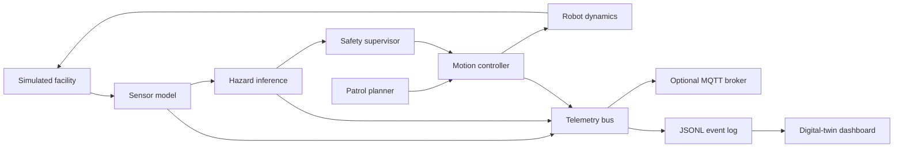

# AI Cyber-Physical Systems Digital Twin

A research-grade, runnable cyber-physical systems (CPS) demonstrator: a simulated mobile inspection robot patrols an industrial environment, fuses sensor telemetry, detects hazards, applies safety-constrained control, and streams its state to a live digital-twin dashboard.

> **Scope and honesty:** this repository currently provides a software simulation and a ROS 2 integration adapter. It does not claim physical-robot testing, certified safety performance, validated industrial gas dispersion, or production deployment. The sensor and environment data are synthetic.

## Why this project

The system brings together several themes relevant to AI-enabled cyber-physical engineering:

- **Cyber-physical modelling:** robot motion, environment, sensor observations and actuator commands are modelled as a feedback system.
- **Autonomy and control:** waypoint patrol, obstacle avoidance and a safety supervisor constrain commanded motion.
- **AI perception:** a lightweight anomaly detector scores multi-sensor hazard observations.
- **Connected systems:** timestamped telemetry is published to JSONL and optionally MQTT.
- **Digital twin:** a Streamlit dashboard visualises robot state, sensor trends, hazard events and mission metrics.
- **Verification:** unit tests cover sensor scoring, safety overrides, deterministic simulation and telemetry structure.

## Architecture



## Quick start

Python 3.10+ is recommended.

```bash
python -m venv .venv
source .venv/bin/activate       # Windows: .venv\Scripts\activate
pip install -e ".[dev]"
python -m cps_twin.cli --steps 600 --seed 7 --output data/run.jsonl
streamlit run cps_twin/dashboard.py
```

The CLI runs a deterministic scenario and writes one JSON object per simulation step. The dashboard can load the generated log or run a fresh simulation.

## Run the tests

```bash
pytest
```

## Optional MQTT telemetry

Start a local Mosquitto broker:

```bash
docker compose up -d
```

Install the optional MQTT dependency and run:

```bash
pip install -e ".[mqtt]"
python -m cps_twin.cli --steps 600 --mqtt localhost
```

Subscribe from another terminal:

```bash
mosquitto_sub -h localhost -t 'cps/robot/#' -v
```

Messages are published to `cps/robot/telemetry` as JSON. MQTT is an optional transport; the simulator remains usable without a broker.

## ROS 2 integration

`ros2/telemetry_node.py` contains a ROS 2 Python node that reads the simulator's JSONL stream and publishes each record as a `std_msgs/msg/String` message on `/cps/robot/telemetry`. It is deliberately separated from the core package so the simulation and tests do not require ROS 2 to be installed.

With a sourced ROS 2 environment and `std_msgs` available:

```bash
python ros2/telemetry_node.py --input data/run.jsonl
```

This adapter demonstrates a transport boundary, not a complete Nav2/SLAM robot stack. A physical deployment would additionally require robot-specific drivers, calibrated sensors, localisation, validated motion planning and hardware-in-the-loop testing.

## Example output fields

Each telemetry record includes:
- simulation time and robot pose `(x, y, yaw)`
- commanded linear/angular velocity
- obstacle range and gas-like sensor reading
- anomaly probability and hazard state
- safety intervention flag and mission waypoint index

## Engineering design decisions

1. **Determinism:** a seeded random generator makes scenarios reproducible.
2. **Separation of concerns:** simulation, inference, safety, transport and presentation are separate modules.
3. **Fail-safe behaviour:** high hazard scores or close obstacles trigger a stop override independently of the planner.
4. **Observability:** each step emits structured telemetry so behaviour can be inspected and replayed.
5. **Testability:** the core logic is pure Python and can be tested without ROS 2, MQTT or a physical robot.

## Limitations and next steps

- Synthetic sensor data is used; no physical sensor calibration has been performed.
- The hazard classifier is a small synthetic-data model and must not be used for real safety decisions.
- Robot dynamics and obstacle handling are simplified; there is no certified collision-avoidance guarantee.
- The ROS 2 adapter publishes telemetry only. Integrating Nav2, SLAM Toolbox, Gazebo/Ignition and real drivers is a future extension.
- MQTT is best-effort in this demonstrator; production systems need authentication, TLS, QoS selection, retained-state policy and reconnection tests.

Potential extensions: Gazebo simulation, Nav2 waypoint execution, SLAM, camera/LiDAR processing, hardware-in-the-loop with microcontrollers, model monitoring, fault injection and safety-case documentation.

## Repository structure

```text
cps_twin/
  models.py       Typed state and telemetry structures
  simulator.py    Environment, robot and sensor simulation
  perception.py   Synthetic-data hazard model
  safety.py       Independent safety supervisor
  telemetry.py    JSONL and optional MQTT transports
  cli.py          Simulation command line
  dashboard.py    Streamlit digital-twin interface
ros2/
  telemetry_node.py
tests/
  test_system.py
docs/
  architecture.md
```

## Reproducibility

All generated data is synthetic and can be recreated using the CLI seed. Record the seed and command when comparing experiments. See [docs/architecture.md](docs/architecture.md) for signal flow and validation notes.
